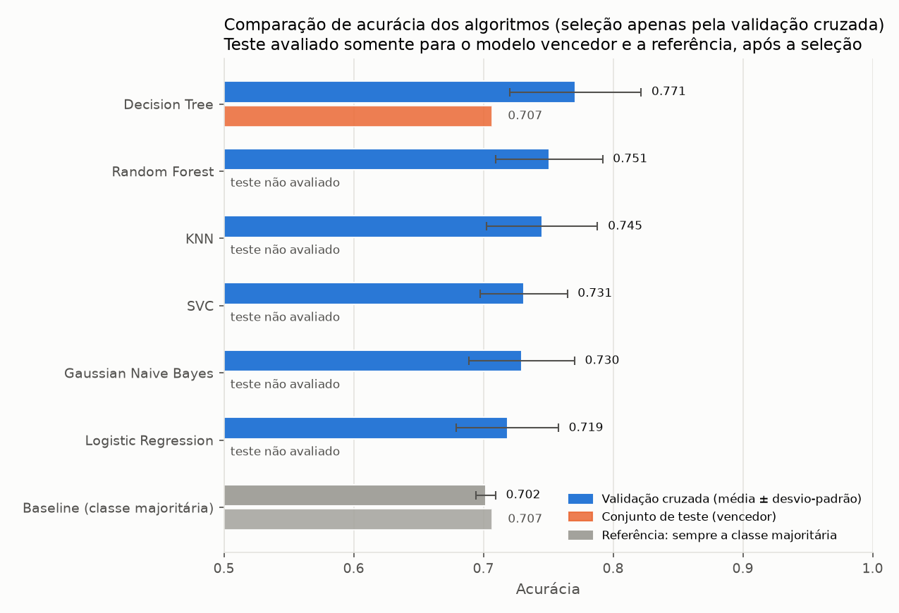
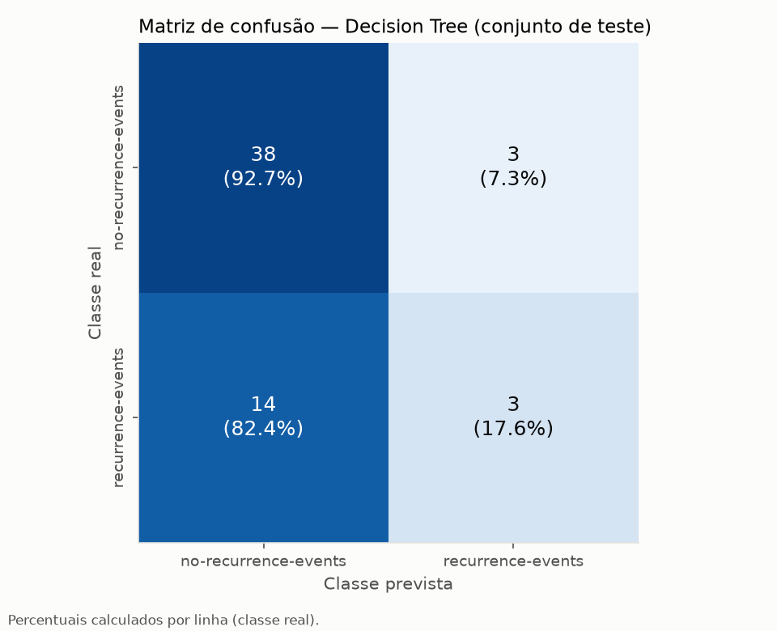

# Breast Cancer Classification

Projeto de classificação binária supervisionada que prevê a **recorrência do câncer de mama**
(`recurrence-events` × `no-recurrence-events`) a partir de nove atributos clínicos categóricos da
base *Breast Cancer* do UCI Machine Learning Repository.

O projeto tem dois módulos principais:

1. **Treinamento** (`python -m src.training`): pré-processa os dados, compara seis algoritmos (com e
   sem balanceamento SMOTE) com validação cruzada estratificada repetida, seleciona o melhor modelo
   pela acurácia média e só então
   avalia no conjunto de teste o vencedor e a referência majoritária. Por fim, salva o pipeline
   completo em `models/best_model.joblib`.
2. **Inferência** (`python -m src.inference`): carrega o pipeline salvo, valida os atributos de uma
   nova paciente e retorna a classe prevista (e as probabilidades, quando o estimador as fornece).

> **Aviso:** os resultados são classificações experimentais baseadas em uma base histórica de 1988.
> Eles **não constituem diagnóstico médico** e não substituem avaliação clínica.

---

## 1. Base de dados

* **Origem:** UCI Machine Learning Repository — <https://archive.ics.uci.edu/dataset/14/breast+cancer>
* **Arquivo utilizado:** `data/breast-cancer.csv` (versão em CSV da base da UCI incluída neste repositório; é a única fonte de dados do projeto).
* **Referência:** Zwitter, M. & Soklic, M. (1988). Breast Cancer [Dataset]. UCI Machine Learning
  Repository. https://doi.org/10.24432/C51P4M.

Os dados foram coletados no Instituto de Oncologia do Centro Médico Universitário de Liubliana
(antiga Iugoslávia).

### Estrutura e atributos

286 registros × 10 colunas (9 preditores + alvo). Todos os atributos são categóricos; a maioria
representa faixas de valores.

| Atributo | Descrição | Valores observados | Tratamento |
|---|---|---|---|
| `age` | Faixa etária no diagnóstico | 20-29 … 70-79 | nominal (one-hot) |
| `menopause` | Status menopausal | `premeno`, `lt40`, `ge40` | nominal (one-hot) |
| `tumor-size` | Diâmetro do tumor (mm) | 0-4 … 50-54 | nominal (one-hot) |
| `inv-nodes` | Linfonodos axilares com metástase | 0-2 … 24-26 | nominal (one-hot) |
| `node-caps` | Penetração na cápsula do linfonodo | `yes`, `no` (+ 8 `?`) | nominal (one-hot) |
| `deg-malig` | Grau histológico de malignidade | 1, 2, 3 | **ordinal** (numérico) |
| `breast` | Mama acometida | `left`, `right` | nominal (one-hot) |
| `breast-quad` | Quadrante acometido | `central`, `left_low`, `left_up`, `right_low`, `right_up` (+ 1 `?`) | nominal (one-hot) |
| `irradiat` | Radioterapia realizada | `yes`, `no` | nominal (one-hot) |
| `Class` | **Alvo** | `no-recurrence-events`, `recurrence-events` | — |

A documentação da UCI usa hífen nos quadrantes (`left-up`); o CSV fornecido usa sublinhado
(`left_up`), grafia adotada no projeto.

## 2. Análise exploratória

Comando: `python -m src.exploratory_analysis` → `reports/exploratory_analysis.txt`,
`reports/class_distribution.png` e `reports/recurrence_rate_by_attribute.png`.

Todas as características informadas foram **confirmadas diretamente no arquivo**:

| Verificação | Resultado |
|---|---|
| Dimensões | 286 registros, 10 colunas |
| `no-recurrence-events` | 201 (70,28%) |
| `recurrence-events` | 85 (29,72%) |
| Valores `?` | 8 em `node-caps`, 1 em `breast-quad` (9 registros, nenhuma célula vazia) |
| Duplicações completas | 14 (28 registros envolvidos) |
| Duplicações só nos preditores | 20 |
| Combinações de preditores com classes diferentes | 6 (13 registros) |

**Associação com a classe** (qui-quadrado; V de Cramér): `deg-malig` (0,33), `inv-nodes` (0,32),
`node-caps` (0,28) e `tumor-size` (0,25) são os atributos mais associados à recorrência; `breast`,
`menopause`, `breast-quad` e `age` têm associação fraca. A taxa de recorrência sobe de 16,9% em
`deg-malig=1` para 52,9% em `deg-malig=3`, e de 21,6% com `inv-nodes=0-2` para 47–67% nas faixas
seguintes. A exceção é `inv-nodes=24-26`, com 100%, mas que corresponde a apenas um registro.
Várias categorias são raras (por exemplo, `age=20-29` tem 1 registro; `inv-nodes=24-26`, 1).

### Desbalanceamento e suas consequências

A razão é de 2,36 negativos para cada positivo. Um classificador trivial que sempre responde
`no-recurrence-events` atinge **70,28%** de acurácia na base inteira (70,18% na validação cruzada e
70,69% no teste) com **recall zero** para a classe de interesse. Por isso:

* a acurácia de cada modelo é sempre comparada com essa referência (incluída na tabela);
* precision, recall, F1 e a matriz de confusão da classe `recurrence-events` são reportados;
* todas as divisões (treino/teste e validação cruzada) são estratificadas.

### Duplicados

Os registros duplicados foram **mantidos**. Como todos os atributos são faixas discretas, é
plausível que pacientes diferentes tenham perfis idênticos, e não há evidência de erro de registro;
removê-los alteraria a distribuição original. As 6 combinações conflitantes (mesmos atributos,
classes diferentes) indicam erro irredutível: nenhum modelo baseado apenas nesses atributos acerta
todos esses casos. Ressalva: cópias idênticas podem cair simultaneamente no treino e no teste, o que
pode tornar as estimativas ligeiramente otimistas.

## 3. Pré-processamento

Implementado em `src/preprocessing.py` com `ColumnTransformer` + `Pipeline` e **embutido no
pipeline de cada modelo**:

1. `?` é convertido em `NaN` na leitura (`src/data.py`); nenhum registro é removido.
2. `Class` é separada dos preditores e nunca é usada como entrada.
3. **Atributos nominais** (8): `SimpleImputer(strategy="most_frequent")` → `OneHotEncoder(handle_unknown="ignore")`.
4. **`deg-malig`** (ordinal): mantido como número (1 < 2 < 3), preservando a ordem natural, com
   `SimpleImputer(strategy="most_frequent")`.
5. **Escalonamento**: nos modelos sensíveis à escala (Logistic Regression, SVC, KNN), `deg-malig`
   recebe `MinMaxScaler`, ficando em [0, 1], a mesma escala das variáveis binárias do one-hot. Árvores,
   Random Forest e Naive Bayes não usam escalonamento.

**Sem vazamento de dados:** como o pré-processamento está dentro do `Pipeline` avaliado pelo
`GridSearchCV`/`RandomizedSearchCV`, imputadores, codificadores e escalonadores são reajustados com
os dados de treino de cada *fold*; no ajuste final, apenas com o conjunto de treinamento.

**Persistência do pré-processamento:** os imputadores, o codificador (`OneHotEncoder`) e, nos
algoritmos que usam normalização, o normalizador (`MinMaxScaler`) ficam salvos dentro do pipeline em
`models/best_model.joblib`, junto com o classificador. Assim, a inferência reutiliza exatamente o
pré-processamento aprendido no treino, sem precisar reconstruí-lo. O modelo selecionado (Decision
Tree) não contém `MinMaxScaler`, pois árvores não são sensíveis à escala (item 5); o normalizador só
faria parte do arquivo salvo se o vencedor fosse Logistic Regression, SVC ou KNN.

Observação: `age`, `tumor-size` e `inv-nodes` também são faixas ordenadas, mas foram tratadas como
nominais (one-hot); apenas `deg-malig` recebe tratamento ordinal. A codificação ordinal dessas três
faixas também foi testada na Decision Tree, com a mesma divisão e a mesma validação cruzada.
Produziu os mesmos hiperparâmetros, a mesma acurácia média (0,7708 ± 0,0507) e a mesma regra de
decisão (prevê `recurrence-events` somente com `inv-nodes ≠ 0-2` e `deg-malig = 3`). Por isso, o
one-hot foi mantido.

## 4. Algoritmos e estratégia de validação

| Algoritmo | Busca | Configurações avaliadas |
|---|---|---|
| Referência (`DummyClassifier`, classe majoritária) | — | 1 (não selecionável; sem SMOTE) |
| Logistic Regression | GridSearchCV | `C` ∈ {0,01; 0,1; 1; 10} × `class_weight` ∈ {None, balanced} × `sampler` = 16 |
| Decision Tree | GridSearchCV | `criterion` × `max_depth` ∈ {2, 3, 4, 5, None} × `min_samples_leaf` ∈ {1, 5, 10} × `sampler` = 60 |
| Random Forest | RandomizedSearchCV | 30 sorteios em `n_estimators`, `max_depth`, `min_samples_leaf`, `max_features`, `class_weight` e `sampler` |
| SVC | GridSearchCV | kernel linear (`C` × `class_weight`) e RBF (`C` × `gamma` × `class_weight`), × `sampler` = 48 |
| KNN | GridSearchCV | `n_neighbors` ∈ {3 … 21} × `weights` × `p` ∈ {1, 2} × `sampler` = 56 |
| Gaussian Naive Bayes | GridSearchCV | `var_smoothing` ∈ 10⁻⁹ … 10⁰ × `sampler` = 20 |

`sampler` ∈ {sem balanceamento (`"passthrough"`), `SMOTE(random_state=42)`} (ver "Balanceamento
(SMOTE)" abaixo). As grades são modestas, compatíveis com 228 registros de treino.

**Validação:**

1. `train_test_split` com 20% para teste, `stratify=y` e `random_state=42` → 228 treino / 58 teste.
2. No treino: `RepeatedStratifiedKFold(n_splits=5, n_repeats=10, random_state=42)` (50 ajustes por
   configuração), reduzindo a dependência de uma única partição.
3. Comparação, ajuste de hiperparâmetros e seleção usam **somente** as métricas de validação
   cruzada no treino. Durante o loop de algoritmos o conjunto de teste não é consultado (a acurácia
   de treino por ressubstituição é registrada apenas como diagnóstico).
4. **Uso do conjunto de teste:** somente depois da seleção, e apenas para avaliar (a) o modelo
   vencedor e (b) a referência majoritária (`DummyClassifier`) definida previamente. Os demais
   candidatos **não são avaliados no teste**: suas colunas `test_*` ficam vazias em
   `model_comparison.csv` (coluna `evaluated_on_test = False`). Nenhum limiar foi ajustado.

**Critério de seleção:** maior acurácia média na validação cruzada. Modelos a até **0,01** (1 ponto
percentual) da melhor acurácia são considerados empatados, e o desempate é o maior recall médio de
`recurrence-events` na validação cruzada. A referência majoritária nunca é selecionável.

### Balanceamento (SMOTE)

* O SMOTE (`imbalanced-learn`) foi avaliado como **hiperparâmetro em todos os algoritmos
  candidatos**: cada busca testa as mesmas configurações sem balanceamento e com SMOTE. O pipeline
  é um `imblearn.pipeline.Pipeline` com as etapas `preprocessor` → `sampler` → `classifier`.
* O SMOTE é aplicado **somente no treino de cada fold** (e, no ajuste final, só no conjunto de
  treinamento). Ele **nunca** é aplicado ao teste nem antes da separação treino/teste; no `predict`
  a etapa é ignorada. Assim, nenhum dado sintético vaza para a avaliação.
* **Resultado:** o SMOTE aumenta o recall de `recurrence-events`, mas reduz a acurácia em todos os
  algoritmos. Como o critério do enunciado é a melhor acurácia, o modelo selecionado **não usa
  SMOTE** (`sampler = "passthrough"` em `best_params`).

Melhor candidato de cada algoritmo, sem e com SMOTE (validação cruzada 5×10 no treino;
`reports/smote_comparison.csv`):

| Algoritmo | Acurácia CV sem SMOTE | Recall CV sem SMOTE | Acurácia CV com SMOTE | Recall CV com SMOTE |
|---|---|---|---|---|
| **Decision Tree** | **0,7708 ± 0,0507** | 0,3481 | 0,7123 ± 0,0568 | 0,4082 |
| Random Forest | 0,7506 ± 0,0413 | 0,3253 | 0,7331 ± 0,0521 | 0,4125 |
| KNN | 0,7453 ± 0,0427 | 0,2784 | 0,6970 ± 0,0480 | 0,5032 |
| SVC | 0,7312 ± 0,0335 | 0,2437 | 0,7150 ± 0,0534 | 0,4702 |
| Gaussian Naive Bayes | 0,7295 ± 0,0408 | 0,2481 | 0,6988 ± 0,0570 | 0,6013 |
| Logistic Regression | 0,7185 ± 0,0393 | 0,2008 | 0,6834 ± 0,0541 | 0,5529 |

Ressalva: o SMOTE atua sobre os atributos já codificados (one-hot e `deg-malig`, este normalizado
nos modelos sensíveis à escala) e
interpola entre vizinhos, gerando valores intermediários nas colunas binárias dos exemplos
sintéticos.

**Métricas** (classe positiva `recurrence-events`): accuracy, balanced accuracy, precision, recall,
F1-score, matriz de confusão e relatório de classificação completo.

## 5. Resultados

Resultados efetivamente obtidos na execução de `python -m src.training` (reproduzíveis com a
semente 42; `reports/model_comparison.csv`).

| Modelo | Acurácia CV (média ± dp) | Recall CV | F1 CV | Acurácia teste | Precision teste | Recall teste | F1 teste |
|---|---|---|---|---|---|---|---|
| **Decision Tree** ✔ | **0,7708 ± 0,0507** | 0,3481 | 0,4670 | 0,7069 | 0,5000 | 0,1765 | 0,2609 |
| Random Forest | 0,7506 ± 0,0413 | 0,3253 | 0,4279 | — | — | — | — |
| KNN | 0,7453 ± 0,0427 | 0,2784 | 0,3873 | — | — | — | — |
| SVC | 0,7312 ± 0,0335 | 0,2437 | 0,3434 | — | — | — | — |
| Gaussian Naive Bayes | 0,7295 ± 0,0408 | 0,2481 | 0,3460 | — | — | — | — |
| Logistic Regression | 0,7185 ± 0,0393 | 0,2008 | 0,2893 | — | — | — | — |
| Referência (majoritária) | 0,7018 ± 0,0076 | 0,0000 | 0,0000 | 0,7069 | 0,0000 | 0,0000 | 0,0000 |

A comparação e a seleção usam apenas as colunas de validação cruzada. O conjunto de teste foi usado
**somente para avaliar o modelo vencedor e a referência majoritária previamente definida**, depois da
seleção; os candidatos não selecionados não foram avaliados no teste ("—" na tabela, vazio no CSV).



### Modelo selecionado

* **Algoritmo:** `DecisionTreeClassifier(criterion="gini", max_depth=2, min_samples_leaf=1, random_state=42)`,
  **sem SMOTE** (`sampler = "passthrough"`).
* **Justificativa:** maior acurácia média na validação cruzada (0,7708); o segundo colocado
  (Random Forest, 0,7506) ficou 2,02 p.p. abaixo, fora da tolerância de empate de 0,01, então o
  critério secundário não foi necessário.
* **Regras aprendidas** (árvore de profundidade 2, ajustada nos 228 registros de treino): prevê
  `recurrence-events` somente quando `inv-nodes ≠ 0-2` **e** `deg-malig = 3`; nos demais casos prevê
  `no-recurrence-events`. Isso é coerente com os atributos mais associados à recorrência na análise
  exploratória.

**Avaliação final no teste (58 registros: 41 negativos, 17 positivos):**

| Métrica | Valor |
|---|---|
| Accuracy | 0,7069 |
| Balanced accuracy | 0,5516 |
| Precision (`recurrence-events`) | 0,5000 |
| Recall (`recurrence-events`) | 0,1765 |
| F1-score (`recurrence-events`) | 0,2609 |

| | prev. `no-recurrence-events` | prev. `recurrence-events` |
|---|---|---|
| **real `no-recurrence-events`** | 38 | 3 |
| **real `recurrence-events`** | 14 | 3 |



**Referência majoritária no mesmo teste** (`DummyClassifier(strategy="most_frequent")`, nunca
selecionável): accuracy 0,7069; balanced accuracy 0,5000; precision, recall e F1 de
`recurrence-events` iguais a 0,0000. Matriz de confusão: 41 negativos e 17 positivos, todos previstos
como `no-recurrence-events`.

### Interpretação crítica

* Na validação cruzada, o modelo supera a referência majoritária em **+6,9 p.p.** (0,7708 × 0,7018)
  e atinge recall de 0,35 na classe minoritária, enquanto a referência tem recall zero.
* **No teste, a acurácia (0,7069) é igual à da referência majoritária**: o ganho de acurácia não se
  confirmou nessa amostra. O modelo identifica apenas 3 dos 17 casos de recorrência (recall 0,18),
  embora acerte 3 em vez de 0, o que se reflete na balanced accuracy (0,55 × 0,50).
* A diferença entre validação cruzada e teste é compatível com (a) o tamanho reduzido do teste: com
  58 registros, o erro-padrão de uma acurácia próxima de 0,7 é cerca de 0,06, e cada acerto vale
  1,7 p.p.; e (b) o leve otimismo de escolher o melhor entre muitas configurações pela mesma
  validação cruzada.
* Com esses dados, nenhum algoritmo separa bem as classes: todos ficam entre 0,72 e 0,77 de acurácia
  na validação cruzada, a poucos pontos da referência de 0,70. Isso é compatível com as combinações
  conflitantes e com o caráter grosseiro (em faixas) dos atributos.
* As probabilidades da árvore são frequências das folhas e **não são calibradas** (uma das folhas
  atribui 100% a `no-recurrence-events`). Devem ser lidas como indicação grosseira, não como risco
  clínico.

## 6. Estrutura do projeto

```
breast-cancer-classification/
├── data/
│   └── breast-cancer.csv           # base original fornecida (não modificada)
├── models/
│   └── best_model.joblib           # pipeline completo (pré-processamento + classificador)
├── reports/
│   ├── exploratory_analysis.txt    # análise exploratória
│   ├── class_distribution.png
│   ├── recurrence_rate_by_attribute.png
│   ├── model_comparison.csv        # comparação (CV de todos; teste só do vencedor e da referência)
│   ├── smote_comparison.csv        # melhor candidato sem SMOTE × com SMOTE, por algoritmo (CV)
│   ├── classification_report.txt   # métricas e relatório do modelo selecionado
│   ├── confusion_matrix.png
│   ├── accuracy_comparison.png
│   └── training_summary.json       # semente, parâmetros, métricas, versões
├── src/
│   ├── __init__.py
│   ├── config.py                   # caminhos, semente, esquema e domínios dos atributos
│   ├── data.py                     # leitura, conversão de '?', validação, separação X/y
│   ├── exploratory_analysis.py     # análise exploratória
│   ├── preprocessing.py            # ColumnTransformer e Pipeline (imblearn, com etapa sampler)
│   ├── training.py                 # busca, comparação, seleção e persistência
│   ├── evaluation.py               # métricas, relatórios e gráficos
│   └── inference.py                # inferência por linha de comando
├── tests/
│   ├── conftest.py
│   ├── test_preprocessing.py
│   ├── test_training.py
│   └── test_inference.py
├── examples/
│   └── nova_paciente.json
├── pytest.ini                      # configuração do Pytest
├── requirements.txt
├── README.md
└── .gitignore
```

Além dos módulos principais (`config`, `preprocessing`, `training`, `evaluation` e `inference`), o
projeto inclui `src/data.py` (leitura e validação reutilizadas
pelo treinamento, pela análise exploratória e pelos testes) e `src/exploratory_analysis.py`
(análise exploratória separada do treinamento).

## 7. Instalação

Requer Python 3.12 ou superior (testado com Python 3.14.4).

```bash
python -m venv .venv
```

Windows:

```bash
.venv\Scripts\activate
```

Linux/macOS:

```bash
source .venv/bin/activate
```

```bash
pip install -r requirements.txt
```

## 8. Execução

Todos os comandos devem ser executados na raiz do projeto (`breast-cancer-classification/`).

**Análise exploratória:**

```bash
python -m src.exploratory_analysis
```

**Treinamento** (cerca de 4 minutos e meio na máquina de desenvolvimento, usando todos os núcleos):

```bash
python -m src.training
```

Opções: `--n-repeats` (repetições da validação cruzada, padrão 10), `--n-jobs` (paralelismo,
padrão -1), `--data`, `--models-dir`, `--reports-dir`.

**Inferência a partir de JSON:**

```bash
python -m src.inference --json examples/nova_paciente.json
```

**Inferência com atributos individuais:**

```bash
python -m src.inference --age 40-49 --menopause premeno --tumor-size 30-34 --inv-nodes 3-5 --node-caps yes --deg-malig 3 --breast left --breast-quad left_low --irradiat yes
```

### Exemplo de entrada e saída

`examples/nova_paciente.json`:

```json
{
  "age": "50-59",
  "menopause": "ge40",
  "tumor-size": "15-19",
  "inv-nodes": "0-2",
  "node-caps": "no",
  "deg-malig": 1,
  "breast": "right",
  "breast-quad": "central",
  "irradiat": "no"
}
```

Saída:

```
Resultado da inferência
Classe prevista: no-recurrence-events
Probabilidades estimadas:
  * no-recurrence-events: 76.39%
  * recurrence-events: 23.61%

Aviso: classificação experimental baseada em uma base histórica (UCI, 1988). Não é diagnóstico médico e não substitui avaliação clínica.
```

A paciente tem `inv-nodes=0-2`, então cai na folha da árvore com 110 negativos e 34 positivos de
treino (110/144 = 76,39%). Para o exemplo com atributos individuais acima (`inv-nodes=3-5`,
`deg-malig=3`), a saída é `recurrence-events` com 77,42% (folha com 24 positivos e 7 negativos).

Exemplo de entrada inválida (`menopause="x"`, `deg-malig=5`, sem `inv-nodes` e com `Class`):

```
Erro: Entrada inválida:
  - Atributos ausentes: ['inv-nodes'].
  - A variável-alvo 'Class' não deve ser enviada para inferência.
  - 'menopause' inválido: 'x'. Valores permitidos: ['lt40', 'ge40', 'premeno'].
  - 'deg-malig' inválido: 5. Valores permitidos: [1, 2, 3].
```

### Regras de validação da inferência

* O arquivo JSON deve estar em UTF-8, com ou sem BOM (o PowerShell 5.1 grava com BOM).
* Os nove atributos são obrigatórios; atributos ausentes são listados na mensagem de erro.
* Chaves extras são rejeitadas, inclusive `Class`: a inferência **não exige nem aceita** a variável-alvo.
* Valores fora do domínio documentado pela UCI são rejeitados, com a lista de valores permitidos.
  Todos os problemas são reportados de uma vez.
* `deg-malig` aceita `1`, `2`, `3` (inteiro ou texto); valores como `2.5`, `4` ou `true` são rejeitados.
* `null` ou `"?"` indicam valor desconhecido: o pipeline imputa a categoria mais frequente do
  treino, e a saída exibe um aviso.
* Categorias **válidas no domínio da UCI, mas ausentes no treino** (por exemplo `age=80-89` ou
  `inv-nodes=30-32`) são rejeitadas por padrão, pois o `OneHotEncoder` as transformaria em um vetor
  de zeros, e o atributo seria ignorado sem aviso. Só são aceitas com `--allow-unseen-categories`,
  com aviso explícito.
* O mesmo vale para `age=20-29`. É uma categoria válida e presente na base original da UCI, mas seu
  único registro ficou no conjunto de teste e, por isso, não foi observado durante o treinamento.
  Ela também é rejeitada por padrão, a menos que se use `--allow-unseen-categories`.
* Modelo ausente, corrompido ou com atributos incompatíveis gera mensagem clara (código de saída 1).
* As probabilidades só aparecem quando o estimador implementa `predict_proba`; caso contrário, a
  saída informa que não estão disponíveis (por exemplo, SVC sem `probability=True`).

## 9. Testes

```bash
python -m pytest
```

Resultado da última execução: **67 testes aprovados** (36 de inferência, 15 de pré-processamento e
16 de treinamento), em poucos segundos. O treinamento usado nos testes é uma versão reduzida e
determinística (3 modelos, 1 repetição da validação cruzada), gravada em diretório temporário.

Os testes cobrem: leitura da base e confirmação de suas características; separação X/y; conversão
de `?`; imputação, one-hot, ordem e escala de `deg-malig`; ausência de vazamento (o pré-processador
aprende moda, categorias e escala apenas das linhas de ajuste, e a busca avalia o pipeline completo);
divisão estratificada, disjunta e reprodutível; regras de seleção e desempate; pipeline do imblearn
com as etapas `preprocessor`, `sampler` e `classifier`; SMOTE como hiperparâmetro de todos os
candidatos (e não da referência); SMOTE reamostrando apenas no `fit`, sem alterar o número de linhas
no `predict`; geração do `smote_comparison.csv`; uso restrito do
conjunto de teste (consultado exatamente duas vezes, após a seleção: vencedor e referência; colunas
de teste vazias para os demais candidatos); treinamento (reduzido,
em diretório temporário); persistência e recarga do pipeline; inferência via função e CLI; validação
do JSON; atributos ausentes, extras e `Class`; categorias inválidas e não vistas no treino;
probabilidades indisponíveis; leitura de JSON com BOM; e compatibilidade entre o pipeline salvo e os dados de entrada. Os
testes não dependem de `models/` nem de `reports/` preexistentes.

## 10. Limitações e ressalvas

* **Base pequena e antiga:** 286 registros de um único centro, coletados nos anos 1980. Protocolos de
  tratamento e estadiamento mudaram desde então; os resultados não se generalizam para a prática atual.
* **Atributos grosseiros:** todos os preditores são faixas ou categorias. Combinações conflitantes e
  duplicados impõem um teto de desempenho.
* **Desbalanceamento:** acurácias em torno de 0,70 a 0,77 estão próximas da referência trivial de
  0,70. O recall da classe `recurrence-events` é baixo em todos os modelos.
* **Variância das estimativas:** o conjunto de teste tem 58 registros (17 positivos); cada acerto
  altera a acurácia em 1,7 p.p. O desvio-padrão da validação cruzada (≈0,04–0,05) é da mesma ordem
  das diferenças entre os modelos.
* **Otimismo da seleção:** hiperparâmetros e algoritmo foram escolhidos pela mesma validação cruzada
  que gera as médias reportadas. Uma validação cruzada aninhada daria uma estimativa menos enviesada.
* **Critério de seleção:** o enunciado dá ênfase à melhor acurácia. Em um uso clínico, perder
  recorrências (falsos negativos) costuma ser mais grave, e critérios como recall, balanced accuracy
  ou ajuste de limiar (com validação apropriada) seriam mais adequados.
* **Probabilidades não calibradas.**
* **Categorias não observadas:** faixas documentadas pela UCI, mas ausentes na base (`age` 10-19,
  80-89, 90-99; `tumor-size` 55-59; várias faixas altas de `inv-nodes`), não podem ser avaliadas
  pelo modelo.
* **Não é ferramenta diagnóstica.** O uso é estritamente educacional e experimental.

## 11. Atribuição e licença da base de dados

| | |
|---|---|
| **Nome** | Breast Cancer |
| **Autores** | Matjaz Zwitter e Milan Soklic |
| **Ano** | 1988 |
| **Fonte** | UCI Machine Learning Repository |
| **Página oficial** | <https://archive.ics.uci.edu/dataset/14/breast+cancer> |
| **DOI** | <https://doi.org/10.24432/C51P4M> |
| **Licença da base** | Creative Commons Attribution 4.0 International (CC BY 4.0) |

O arquivo `data/breast-cancer.csv` foi mantido **sem modificações** neste projeto: o tratamento dos
valores `?` e todo o pré-processamento ocorrem apenas em memória, durante a execução.

A licença CC BY 4.0 refere-se **somente à base de dados**. Ela não se aplica automaticamente ao
código-fonte deste projeto.

## Referência

Zwitter, M. & Soklic, M. (1988). Breast Cancer [Dataset]. UCI Machine Learning Repository.
https://doi.org/10.24432/C51P4M.
